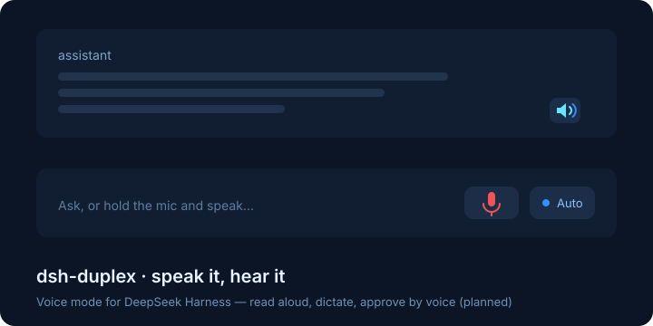

# dsh-duplex 语音双工

**Hands-free voice mode for DeepSeek Harness: speak your request, hear the result, approve by voice.**

## 功能 / What it does

- **朗读回复 / Read replies aloud**：每条助手回复旁有朗读按钮，支持暂停、继续、停止；Markdown 代码块与链接会被跳过并用语音提示。
- **自动朗读 + 本轮摘要 / Auto-read with turn summary**：输入框"自动读"开关；新回复稳定后自动朗读，并在前面补一句本轮工具活动摘要（如"本轮用了 3 个工具：bash ×2、read"）。
- **语音输入 / Dictate**：输入框麦克风把语音转写写入草稿，可开启自动发送。
- **语音审批 / Voice approval**：开启后，待审批操作会被播报，并接受口头"批准/拒绝"；`bash`、`pwsh`、`terminal`、`computer`、`browser` 等高风险工具必须再说一次"确认批准"。默认关闭，可在输入框工具栏开启。
- **提问与计划 / Questions and plans**：单选且选项 ≤5 的问题可按序号或名称回答；计划评审可说批准/拒绝。多选与多问题只播报，不代答。

## 使用 / Usage

1. 在 DSH 里打开任意会话。
2. 想听：点回复旁的朗读按钮，或打开"自动读"。
3. 想说：点输入框的麦克风，说完后转写会进入草稿（默认不自动发送）。
4. 想语音审批：点输入框的 `🎙 语音审批` 开关；审批出现时会播报并等待你的口头决定。

## 安全设计 / Safety

- 语音审批默认关闭；没有明确口头决定绝不批准，静音、噪音、听不清都会留在界面上。
- 高风险工具二次确认；确认环节说"取消"即中止。
- 已作答/已撤回的请求直接跳过；多选与多问题不代答。
- 不保存音频与转写；语音决定就是普通 DSH 审批，会进入会话审计。
- **没有 LLM 替你做决定**：与自动审批类插件不同，本插件不会自行编造审批结论。

## 限制 / Limitations

- 语音合成使用系统音色，质量取决于操作系统；本版不含神经 TTS。
- Electron 桌面端的浏览器语音识别通常不可用（TTS 与语音审批可用）；语音输入请用 Chrome/Edge 打开 Web UI。
- 浏览器语音识别多数实现依赖网络服务；插件本身不保存、不上传任何音频或转写。
- 语音审批依赖 DSH 0.2.1+ 的 `uiSession.sessionStatus`；更早宿主上开关无效。
- 与 DeepSeek 官方无隶属关系。

## 隐私 / Privacy

- 朗读完全在本地进行，不发起网络请求。
- 语音识别由浏览器自带的识别服务完成，行为受浏览器策略约束；插件不记录、不持久化音频。
- 各开关只保存在本机 `localStorage`。
